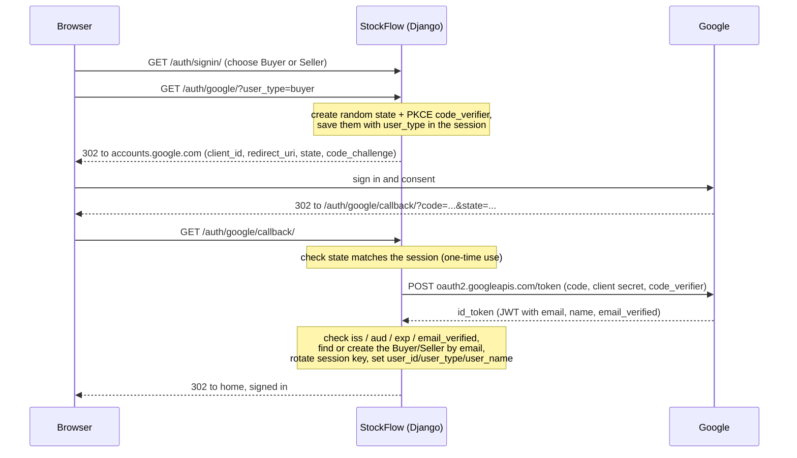

# Google Sign-In (OAuth 2.0) for StockFlow

This guide explains how StockFlow's "Continue with Google" sign-in works and how it was set up. For each step it covers what we did and why, so you can maintain it, set it up again in a new Google Cloud project, or debug it.

- **Code:** `core/google_oauth.py`, wired up in `core/urls.py`
- **Live callback:** `https://stock-flow-chi-ten.vercel.app/auth/google/callback/`
- **Environment variables:** `GOOGLE_CLIENT_ID`, `GOOGLE_CLIENT_SECRET`

---

## 1. Why we replaced email OTP with Google

Before this change, StockFlow had its own email + password accounts:

- Signup sent a 6-digit **OTP by email**, and so did "forgot password".
- Emails went out through **Gmail SMTP**, which needed a Gmail App Password stored as `EMAIL_HOST_PASSWORD`.
- Before sending, the app checked the recipient with an SMTP `RCPT` probe, which could take up to 12 seconds per signup.

That setup had real costs:

| Problem | Effect |
|---|---|
| We stored password hashes and ran password resets ourselves | More security-sensitive code to maintain |
| OTP mail went through a personal Gmail account | Mail could land in spam, Gmail rate limits applied, and the app password was a secret that could leak |
| Each signup made slow SMTP calls | Slow, and sometimes failing, requests on serverless hosting |
| Five extra screens (verify OTP, resend, forgot password, reset password, change password) | More code, templates and things to break |

With Google sign-in, **Google handles passwords and has already verified the email address**. StockFlow never sees a password and never sends email. All of the OTP, password reset, change password and SMTP code was deleted.

---

## 2. How it works



Step by step:

1. **The user picks a role.** StockFlow keeps buyers and sellers in two separate tables, and the same Google account can have one of each. Google doesn't know about roles, so the sign-in page sends `user_type` along with the request.
2. **`google_login`** (`/auth/google/`):
   - It checks the role, and checks that the Google credentials are configured.
   - It creates a random `state` and a PKCE `code_verifier`, and stores both with `user_type` in the session under `google_oauth`.
   - It redirects to Google's consent page, asking only for the `openid email profile` scopes.
3. **Google** signs the user in, shows the consent screen and redirects back to our callback with a one-time `code`.
4. **`google_callback`** (`/auth/google/callback/`):
   - It takes the `google_oauth` entry out of the session, so a callback can never be replayed.
   - It rejects the request if the user cancelled, if the `state` doesn't match, or if the session entry is missing.
   - It exchanges the code for tokens (`_exchange_code`), sending the client secret and the PKCE `code_verifier`.
   - It decodes the ID token and checks its claims (`_id_token_claims`).
   - It accepts only a **verified** email.
   - It looks up the account by email in the Buyer or Seller table. If there's no account yet, it creates one (name from Google, empty phone) along with its wallet.
   - It starts the session with `_login_session` (in `core/views.py`), which rotates the session key, then redirects to home.

---

## 3. Design decisions and why

| Decision | Why |
|---|---|
| **Written by hand with `urllib`**, no new library | The app already calls Gemini the same way (`core/chatbot_view.py`). Libraries like django-allauth assume Django's built-in `User` model, but StockFlow has its own `Buyer` and `Seller` tables. The whole flow is about 150 lines we fully control, with no new dependency. |
| **Authorization code flow** (server side) | The client secret stays on the server, and tokens never pass through the browser. |
| **PKCE** (`code_challenge` / `code_verifier`, S256) | If someone intercepts the authorization code, they still can't exchange it without the verifier, which never leaves our session. Google recommends PKCE even for server apps. |
| **`state` parameter**, stored in the session and single-use | Stops login-CSRF attacks, where an attacker tricks you into finishing *their* login, and replayed callbacks. It's compared with `secrets.compare_digest`. |
| **ID token claims checked, not its signature** | The token comes straight from Google's token endpoint over HTTPS, in a request we made with our client secret. OpenID Connect Core §3.1.3.7 allows trusting TLS in this case. We still check `iss` (Google), `aud` (our client ID) and `exp` (not expired). |
| **Only `email_verified` accounts** | The email is what links a Google login to a StockFlow account, so it must be one Google has verified. |
| **Accounts matched by email + role** | Keeps the existing two-table design. Accounts created before Google sign-in still work: signing in with the same email and role finds them. |
| **Session key rotated on login** (`cycle_key`) | Prevents session fixation. The old code set the session keys without rotating. |
| **`redirect_uri` built from the request** (`build_absolute_uri`) | The same code works on localhost, preview and production. On Vercel, the existing `USE_X_FORWARDED_HOST` and `SECURE_PROXY_SSL_HEADER` settings make it produce the real `https://` host. |
| **Phone is now optional** (migration `0009_google_signin`) | Google doesn't provide a phone number. Users can add one on their profile page. |
| **Email can't be edited on the profile** | It comes from Google and identifies the account. If users could change it, they could take over another account's email. |
| **Removed** the JSON `/signup/` and `/signin/` APIs, OTP and reset pages, change password, the `EmailOTP` model and all `EMAIL_*` settings | They only existed for password accounts. Old URLs now return 404, and `/auth/signup/` redirects to `/auth/signin/`. |

---

## 4. Code map

| File | What's there |
|---|---|
| `core/google_oauth.py` | `google_login`, `google_callback`, `_exchange_code` (token request), `_id_token_claims` (claim checks), `_redirect_uri` |
| `core/views.py` | `_login_session` (rotates the session and sets `user_id`/`user_type`/`user_name`), `_get_or_create_wallet`, `signin_page` (renders the page), `signup_page` (redirects to sign-in) |
| `core/urls.py` | `auth/google/` and `auth/google/callback/`, plus `privacy/` and `terms/` |
| `core/templates/auth.html` | Buyer/Seller choice and a "Continue with Google" button inside a `GET` form pointing at `google_login` |
| `core/templates/profile.html` | Name and phone are editable; email is read-only |
| `core/templates/legal.html` | Privacy Policy and Terms of Service pages, which Google requires before you can publish the consent screen |
| `config/settings.py` | `GOOGLE_CLIENT_ID` and `GOOGLE_CLIENT_SECRET` read from the environment |
| `core/migrations/0009_google_signin.py` | Drops `EmailOTP` and makes `phone` optional |
| `core/tests.py` | `GoogleAuthTests` and `AccountSessionTests` |

---

## 5. Google Cloud setup, step by step

These steps live in **Google Cloud Console → Google Auth Platform** (formerly "OAuth consent screen" under APIs & Services).

### 5.1 Create a project
1. Go to https://console.cloud.google.com, open the project picker, choose **New project** and name it `StockFlow`.
2. Make sure it's selected before you continue.

**Why:** OAuth clients, the consent screen and its settings all belong to a project. A dedicated project keeps StockFlow's settings separate from anything else in the account.

### 5.2 Branding
Under **Google Auth Platform → Branding**:

| Field | Value |
|---|---|
| App name | `StockFlow` |
| User support email | the project's email |
| Application home page | `https://stock-flow-chi-ten.vercel.app/` |
| Application privacy policy link | `https://stock-flow-chi-ten.vercel.app/privacy/` |
| Application terms of service link | `https://stock-flow-chi-ten.vercel.app/terms/` |
| Authorized domains | `stock-flow-chi-ten.vercel.app` |
| Developer contact email | the project's email |

**Why:**
- This is what users see on Google's consent screen.
- Google **won't let you publish** the app until Branding is complete. The privacy policy link is required, which is why we added the `/privacy/` and `/terms/` pages, and why the home page footer links to them.
- `vercel.app` is a shared domain (it's on the Public Suffix List), so the authorized domain is our full subdomain.
- **Don't upload a logo.** A logo triggers Google's brand verification, which can take days.

### 5.3 Audience: publish the app
1. Set **Audience → User type** to **External**, so anyone with a Google account can sign in.
2. Click **Publish app** and confirm.

**Why:** in "Testing" status, only the test users you list (up to 100) can sign in; everyone else sees "Access blocked". We only request the basic scopes (`openid`, `email`, `profile`), which are non-sensitive, so Google lets you publish without an app review.

### 5.4 Data access (scopes)
The scopes are `openid`, `email` and `profile`. These are the defaults, and the code requests them itself.

**Why:** this is the minimum needed to get a verified email and a display name. Asking for less makes the consent screen less alarming and avoids Google's verification process.

### 5.5 Create the OAuth client
1. Under **Clients → Create client**, choose **Web application** and name it `StockFlow web`.
2. Add these **Authorized redirect URIs**, exactly as written, including the trailing `/`:
   ```
   https://stock-flow-chi-ten.vercel.app/auth/google/callback/
   http://localhost:8000/auth/google/callback/
   http://127.0.0.1:8000/auth/google/callback/
   https://stock-flow-git-<branch>-darshv.vercel.app/auth/google/callback/   (optional, per branch you want to test)
   ```
3. Leave "Authorized JavaScript origins" empty, because the browser never calls Google directly.
4. Click **Create**. Copy the **Client ID** (ends in `.apps.googleusercontent.com`) and **Client secret** (starts with `GOCSPX-`), and click **Download JSON** as a backup.

**Why:**
- "Web application" is the client type for a server that can keep a secret.
- Google only redirects back to URIs registered **exactly** (scheme, host, path and trailing slash), and wildcards aren't allowed. This stops an attacker from receiving your users' authorization codes.
- Both `localhost` and `127.0.0.1` are registered because browsers treat them as different hosts with separate cookies.
- **Google shows the secret only once.** If you lose it, create a new secret on the same client.

---

## 6. Configuration

### Local development (`.env` in the project root)
```
GOOGLE_CLIENT_ID=xxxxxxxx.apps.googleusercontent.com
GOOGLE_CLIENT_SECRET=GOCSPX-xxxxxxxx
DEBUG=True
```
Then run:
```powershell
uv run python manage.py runserver 127.0.0.1:8000
```
Open http://127.0.0.1:8000/auth/signin/. Use the same host all the way through: if you start on `127.0.0.1`, don't switch to `localhost` partway.

**Why `DEBUG=True` locally:** when `DEBUG` is off, the session cookie is HTTPS-only (`SESSION_COOKIE_SECURE`). Over plain `http://` the browser would drop it, the saved `state` would be lost, and you'd see "Your sign-in session expired".

### Vercel (Preview + Production)
| Variable | Type | Value |
|---|---|---|
| `GOOGLE_CLIENT_ID` | Config | the client ID |
| `GOOGLE_CLIENT_SECRET` | **Sensitive** | the client secret |

We added both with:
```powershell
vercel env add GOOGLE_CLIENT_ID preview --value <id> --no-sensitive
vercel env add GOOGLE_CLIENT_ID production --value <id> --no-sensitive
vercel env add GOOGLE_CLIENT_SECRET preview --value <secret> --sensitive
vercel env add GOOGLE_CLIENT_SECRET production --value <secret> --sensitive
```
**Why sensitive:** sensitive values can't be read back from the dashboard or with `vercel env pull`, so the secret can't leak from there. The client ID isn't secret, since it appears in every login URL.

If either variable is missing, the sign-in page shows "Google sign-in is not configured yet." instead of failing with an error.

---

## 7. How we rolled it out

1. **Feature branch `feat/google-oauth`.** We wrote the code, the migration and the tests, and ran `python manage.py test`.
2. **Pushed the branch, which built a protected preview.** Thanks to Neon preview branching, the preview got **its own copy of the database**, so migration `0009` ran there first and couldn't affect production data.
3. **Tested on the branch URL** `stock-flow-git-feat-google-oauth-<team>.vercel.app`, which is registered in Google. *Why not the per-deployment URL* (`stock-flow-<hash>-<team>.vercel.app`)? It changes on every push and can't be registered with Google, so it fails with `redirect_uri_mismatch`.
4. **Checked `vercel logs`.** The callback returned 302, signed-in pages returned 200, and there were no 5xx errors.
5. **Merged into `main`.** Vercel deployed production automatically and applied migration `0009` to the production database.
6. **Removed the old `EMAIL_*` and `DEFAULT_FROM_EMAIL` variables** from Vercel, **after** the merge, because the old production code still needed them until then.
7. **Revoke the Gmail App Password** (Google Account → Security → App passwords), since nothing uses it anymore.

---

## 8. Testing

Automated tests (`uv run python manage.py test`). These mock Google's token endpoint, so they run offline:

- The login redirect contains the client ID, `state` and an S256 `code_challenge`, and the callback URL is correct.
- An invalid `user_type` is rejected.
- A new buyer gets an account and a wallet, and is signed in.
- An existing seller signs into their existing account, matched by email regardless of letter case.
- The callback is rejected when `state` doesn't match, when the email isn't verified, or when the token was issued for another app (`aud`).
- A callback can't be replayed.
- The profile saves name and phone but ignores any attempt to change email.

Manual check after any change:
1. Sign in as Buyer. You should land on home with a welcome message.
2. Sign out, then sign in as Seller with the same Google account. That creates a separate seller account.
3. Sign in again. It should reuse the existing accounts.
4. Add a phone number on the profile page.

---

## 9. Troubleshooting

| Symptom | Cause | Fix |
|---|---|---|
| Google says *"doesn't comply with Google's OAuth 2.0 policy… register the redirect URI"* (`redirect_uri_mismatch`) | The callback URL isn't registered exactly. Common causes: using a per-deployment preview URL, a different host, or a missing trailing slash. | Use the production or branch URL, or add the exact URI shown in "Request details" to the client. Changes take a few minutes to apply. |
| Branch preview stopped working after renaming the Vercel team | The branch URL contains the team slug (it changed from `-hotrodminers` to `-darshv`). | Register the new branch URL. |
| *"Access blocked: app is in testing"* | The consent screen isn't published. | Audience → **Publish app**, or add the user as a test user. |
| "Google sign-in is not configured yet." | `GOOGLE_CLIENT_ID` or `GOOGLE_CLIENT_SECRET` is missing in this environment. | Add it to `.env`, or to Vercel for the right environment, then redeploy. |
| "Your sign-in session expired. Please try again." | The session cookie was lost between login and callback: you switched host (`localhost` ↔ `127.0.0.1`), used `DEBUG=False` over http, blocked cookies, or reused an old callback URL. | Stay on one host, use `DEBUG=True` locally and start again. |
| "Could not complete Google sign-in." | The token exchange or claim check failed. Usually a wrong or rotated client secret (`invalid_client`), or an ID token for a different client ID. | Check that both variables come from the same OAuth client, and that a new secret was added to Vercel and redeployed. |
| "Your Google account email is not verified." | The Google account's email isn't verified. | Verify the email in the Google account. |

---

## 10. Security notes

- **Rotating the secret:** add a new secret on the OAuth client, update `GOOGLE_CLIENT_SECRET` in Vercel (Preview + Production) and in `.env`, redeploy, then delete the old secret in Google Cloud.
- **What StockFlow stores from Google:** only name and email. It stores no Google tokens. The ID token is used once and discarded, and refresh tokens aren't requested.
- **Revoking access:** users can remove StockFlow at https://myaccount.google.com/permissions.
- **Deleting accounts:** an account is deleted, or anonymized if it appears in other users' order history. Either way the email is freed, so the same Google account can sign up again. See the Privacy Policy at `/privacy/`.
